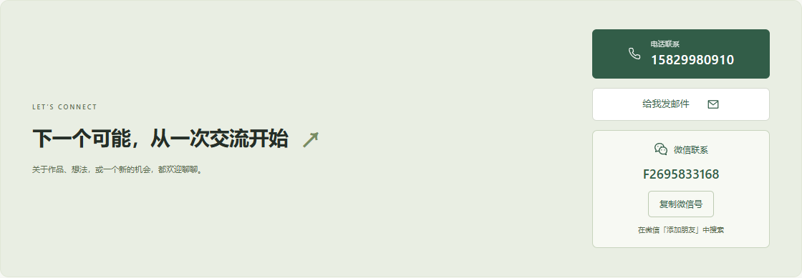
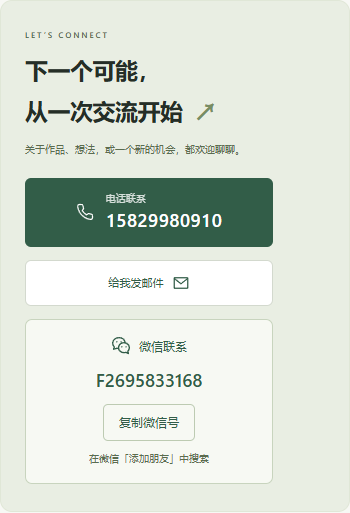

# 网站维护演示

网站：https://525159.github.io/fu-junyang-portfolio/

## 示例一：添加或修改联系方式

1. 登录 GitHub，打开 [个人信息文件](https://github.com/525159/fu-junyang-portfolio/blob/main/src/config.ts)。
2. 点击文件右上角的铅笔图标（Edit this file）。
3. 找到 `social`，只修改引号内的内容，保留引号和逗号：

```ts
social: {
  phone: "15829980910",
  email: "2695833168@qq.com",
  weixin: "F2695833168",
},
```

`phone` 是电话，`email` 是邮箱，`weixin` 是微信号。不展示的联系方式留空为 `""`。只修改引号里的值，保留这些字段名；不需要修改页面组件或图标代码。

4. 点击 **Commit changes…**，填写修改说明，例如“更新联系方式”，选择直接提交到 `main`，再确认 **Commit changes**。
5. 打开 [Actions 发布记录](https://github.com/525159/fu-junyang-portfolio/actions)，等待最新一次 **Deploy portfolio** 显示绿色对勾，再刷新网站。

点击网站右上方“聊一聊”会跳转到底部；底部会显示电话号码。手机点击号码可以打开拨号界面，是否拨出由你确认。

微信联系卡片会直接显示微信号，点击“复制微信号”后，在微信“添加朋友”中粘贴搜索。微信号不能当作普通网页链接使用；复制权限不可用时，可以长按或选中页面上的微信号手动复制。

电脑显示效果：



手机显示效果：



## 示例二：添加一个真实项目

1. 打开 [项目模板](https://github.com/525159/fu-junyang-portfolio/blob/main/templates/project.md)，复制其完整内容。
2. 打开 [项目文件夹](https://github.com/525159/fu-junyang-portfolio/tree/main/src/content/projects)，点击 **Add file → Create new file**。
3. 文件名填写英文，例如 `my-first-app.md`，粘贴模板。
4. 修改项目名称、简介、技术和正文。把 `draft: true` 改成 `draft: false`，保留 `sample: false`。
5. 项目已上线时，去掉 `demoUrl` 那行开头的 `#`，填入完整应用网址，例如 `https://你的应用地址`。封面和“立即体验”就会链接到该应用。
6. 按上面的方式提交，等待 Actions 绿色对勾，刷新网站即可。

截图可以在 [图片文件夹](https://github.com/525159/fu-junyang-portfolio/tree/main/public/images) 通过 **Add file → Upload files** 上传。上传 `my-project.png` 后，在项目文件中填写 `cover: "/images/my-project.png"`。暂时没有截图，可以保留模板的默认封面。

第一个真实项目发布后，三个布局样例会自动隐藏。联系方式属于个人信息，修改 `src/config.ts` 即可；新增作品才需要增加项目 Markdown 文件。
